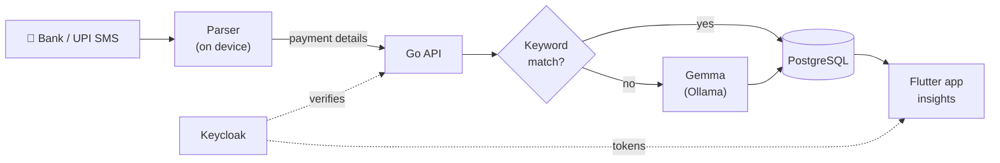

<p align="center">
  
</p>

<h1 align="center">kharcha</h1>

<p align="center">
  <b>Your payments, tracked for you.</b><br>
  An open-source expense tracker that reads bank and UPI messages, works out
  the amount, merchant and category, and turns them into spending insights.
</p>

<p align="center">
  
  
  
  
  
  
</p>

<p align="center">
  <a href="#features">Features</a> ·
  <a href="#how-it-works">How it works</a> ·
  <a href="#getting-started">Getting started</a> ·
  <a href="#api">API</a> ·
  <a href="#project-structure">Structure</a> ·
  <a href="#contributing">Contributing</a>
</p>

---

## Why kharcha?

*Kharcha* (खर्चा) means "expense". Most of what you spend already arrives as
an SMS from your bank or UPI app. kharcha reads those messages on your phone,
records each payment once, and sorts it into a category, so you see where
your money went without typing anything in.

## Features

| | |
| --- | --- |
| 📩 **Automatic detection** | Reads bank and UPI SMS on Android: recent history on first run, then new payments as they arrive. The same message is never saved twice. |
| 🏷️ **Smart categories** | Keyword rules for well-known merchants, a person-name check for transfers, and a local LLM (Gemma via Ollama) for the rest. Anything saved while the model is offline is categorised later. |
| 📊 **Spending insights** | Monthly summary, category breakdown and an activity feed with spent / received filters. |
| 🔐 **Stays signed in, safely** | Keycloak sign-in with an offline refresh token kept in the Android Keystore. The password is never stored. |
| ✍️ **Manual entries** | Add cash or missed payments by hand and edit your profile. |
| 🧾 **Audit logging** | Every API request is recorded for troubleshooting. |

> **Privacy:** messages are parsed on the device; only the payment details
> (amount, merchant, bank, time) are sent to *your own* API. OTPs,
> reminders, failed payments and offers are ignored.

## How it works



## Tech stack

| Layer | Technology |
| --- | --- |
| Mobile / web app | Flutter (Android, web), secure storage, platform channels for SMS |
| API | Go, chi router, GORM, go-playground/validator |
| Database | PostgreSQL |
| Auth | Keycloak (password grant + offline refresh tokens) |
| Categorisation | Keyword rules + any OpenAI-compatible LLM endpoint (Gemma via Ollama) |

## Getting started

### Requirements

- Go 1.26+
- Flutter with Dart 3.13+ and the Android SDK
- PostgreSQL 16+ and Keycloak 26+ (run them however you like, e.g. Docker)
- Optional: [Ollama](https://ollama.com) for automatic categories

### 1. Configure

```sh
cp backend/.env.example backend/.env
```

Fill in every value in `backend/.env` for your own environment: database
connection, Keycloak address, realm, client and admin account, and the
category model endpoint. Each setting is described in
`backend/.env.example`.

The code has **no built-in defaults**: the API refuses to start and names any
missing setting.

> [!IMPORTANT]
> Never commit `backend/.env` (it is git-ignored). Use your own realm and
> client names and strong, unique passwords and secrets.

### 2. Start PostgreSQL and Keycloak

Run a PostgreSQL database and a Keycloak server, then point the database and
Keycloak settings in `backend/.env` at them. Docker files are not part of the
repo; any local `docker-compose*.yml` or `Dockerfile` is git-ignored.

### 3. Set up Keycloak (once)

In the Keycloak admin console:

1. Create a realm for the app's users.
2. In that realm, create a client with **Client authentication** on and
   **Direct access grants** ticked (leave Authorization off).
3. Copy the client secret from its **Credentials** tab into `backend/.env`,
   along with the realm and client names you chose.

Sign-in requests the `offline_access` scope so the app can stay signed in;
new realms allow it by default.

### 4. Start the category model (optional)

```sh
brew install ollama
brew services start ollama
ollama pull gemma3:4b          # or gemma3:1b if disk space is tight
```

Point the classifier settings in `backend/.env` at Ollama's
OpenAI-compatible endpoint and the model you pulled. Without a model,
expenses are saved as `Unknown` and categorised once it is reachable.

> [!TIP]
> A merchant keeps landing in the wrong category? Add a keyword for it in
> `backend/internal/expense/category.go`; rules are checked before the model.

### 5. Run

```sh
make api                              # start the API
make app API_BASE_URL=<your-api-url>  # run the app on a connected device
make test                             # Go + Flutter tests
make lint                             # gofmt / go vet + flutter analyze
```

Run `make help` to list every task.

<details>
<summary><b>Running on a phone over USB</b></summary>

Enable **Developer options → USB debugging** on the phone, connect it and
accept the prompt. Then forward the API port so the phone can reach the API
on your computer:

```sh
adb reverse tcp:<api-port> tcp:<api-port>
cd frontend
flutter run -d <device-id> --dart-define=API_BASE_URL=http://127.0.0.1:<api-port>
```

Tap **Turn on auto-detect** in the app and allow SMS access.

Native code or new plugins (e.g. `MainActivity.kt`, secure storage) need a
full `flutter run`; hot reload will not pick them up.
</details>

<details>
<summary><b>Running in the browser</b></summary>

```sh
cd frontend
flutter run -d chrome --dart-define=API_BASE_URL=<your-api-url>
```

SMS detection is Android-only; everything else works on the web.
</details>

## API

All routes live under `/api/v1`. Routes marked 🔒 need
`Authorization: Bearer <access_token>`.

| Method | Path | Description |
| --- | --- | --- |
| `POST` | `/api/v1/register` | Create an account |
| `POST` | `/api/v1/login` | Get an access token and an offline refresh token |
| `POST` | `/api/v1/auth/refresh` | Swap a refresh token for new tokens |
| `PUT` | `/api/v1/profile` 🔒 | Update first and last name |
| `POST` | `/api/v1/expense` 🔒 | Save a transaction; categorised automatically. Returns 200 with no data if `source_ref` was already saved |
| `GET` | `/api/v1/expenses` 🔒 | List your transactions, newest first (`?limit=`, max 500) |

```sh
curl -X POST "$API_URL/api/v1/login" \
  -H "Content-Type: application/json" \
  -d '{"email":"user@example.com","password":"<your-password>"}'
```

Full reference with request and response examples: [docs/API.md](docs/API.md) ·
Analytics design: [docs/ANALYTICS.md](docs/ANALYTICS.md) ·
Planned APIs: [docs/ROADMAP.md](docs/ROADMAP.md)

## Project structure

```
backend/                     Go API
├── cmd/api/                 entrypoint: loads .env, migrates, starts the server
├── cmd/server/              HTTP server with timeouts
├── cmd/middleware/          audit logging, CORS, bearer-token auth
└── internal/
    ├── handler/             HTTP handlers
    ├── register/            auth service and repository interface
    ├── expense/             categorisation rules, LLM classifier, backfill
    ├── postgres/            repositories: Keycloak + Postgres
    ├── models/              GORM models (User, Transaction, AuditLog)
    ├── db/                  migrations
    ├── utils/               config from environment variables
    └── adapters/response/   JSON response envelope

frontend/                    Flutter app
└── lib/
    ├── api/                 API client, auth, expenses, profile
    ├── services/            SMS source, payment parser, auto-detect, session store
    ├── screens/             login, register, home, add expense, profile
    ├── theme/ widgets/      dark theme, shapes
    └── models/

docs/                        API reference, analytics design, roadmap
Makefile                     tasks for both projects
```

## Security

- Secrets live only in `backend/.env`, which is git-ignored.
- The app never stores the user's password, only a revocable refresh token
  in the platform keystore.
- Please report security issues privately rather than in public issues.

## Contributing

Issues and pull requests are welcome!

1. Fork the repo and create a branch.
2. Make your change with tests.
3. Run `make test` and `make lint`.
4. Open a pull request describing what and why.

Good first contributions: SMS formats from more banks
(`frontend/lib/services/payment_parser.dart`) and merchant keywords
(`backend/internal/expense/category.go`).

<p align="center">Made with ☕ and too many UPI notifications.</p>
