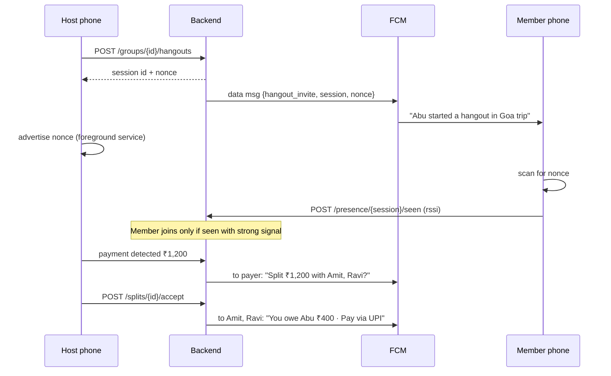
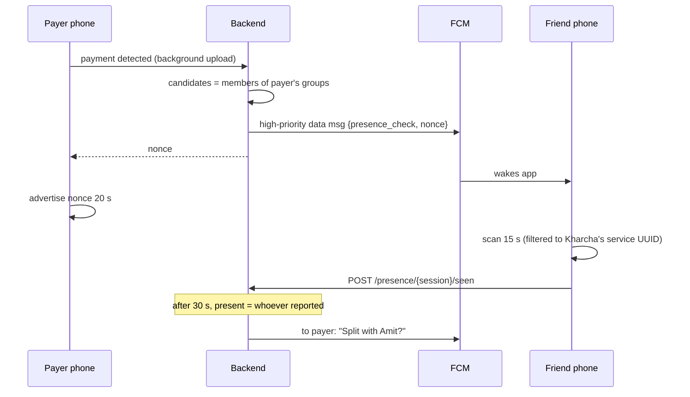

# Auto-split when friends are together

Status: **proposal** · Platform: **Android** (the project has no iOS app)

## Goal

When members of a group are physically together and one of them pays (a UPI
or card payment Kharcha already detects from SMS or app notifications), split
that payment between the people who were there, without anyone typing it in.

### What "auto pay" can and cannot mean

Kharcha cannot move money out of a friend's bank account. That needs an RBI
payment-aggregator licence or a UPI AutoPay mandate per friend. What the app
can do automatically:

1. Notice who was present.
2. Record the split as debts (like Splitwise does).
3. Let each friend settle in one tap with a prefilled UPI link:
   `upi://pay?pa=abu@okhdfc&pn=Abu&am=400.00&tn=Dinner%20at%20Toit`

## Building blocks

| Piece | Good at | Can't do |
|---|---|---|
| **Bluetooth LE** | Proving two phones are within ~10 m, works offline, no location prompt on Android 12+ | Wake a sleeping phone; reach phones that aren't nearby |
| **FCM** | Waking any phone in seconds, delivering the "split?" and "you owe" messages | Knowing where a phone is |
| **Payment detection** (exists) | Knowing *that* the user paid, how much, where | Knowing who they were with |

FCM wakes the right phones; Bluetooth confirms which of them are actually
nearby.

## Approaches compared

### A. Always-on Bluetooth presence

Every phone advertises and scans in the background all the time; the server
keeps a live "who is near whom" map. Any payment is matched against it.

- ✅ Fully automatic, presence is known before the payment
- ❌ Constant battery drain and a permanent foreground notification
- ❌ OEM battery killers (Xiaomi, Oppo, Vivo) stop it within hours
- ❌ Collects location-like data all day, a privacy problem

### B. Hangout mode: manual start, verified by Bluetooth

Someone taps **"We're together"** in a group. FCM invites the other members;
their phones join only if they can hear the host over Bluetooth. Every payment
by a participant during the session is proposed as a split.

- ✅ Reliable: a foreground service runs only while the hangout lasts
- ✅ Clear consent: people know when they're being "grouped"
- ✅ No background upload problem: the session is known before anyone pays
- ❌ One tap per outing

### C. On-demand check per payment (FCM wake + Bluetooth)

No button. When a payment is detected, the server sends a high-priority FCM
message to the payer's group members; their phones wake, scan for the payer's
Bluetooth beacon for ~15 s and report back. Whoever heard it is in the split.

- ✅ Fully automatic, near-zero battery cost (scans only when someone pays)
- ✅ Nothing runs between payments
- ❌ The payer's phone must report the payment **immediately**, in the
  background. Today detected payments are queued and uploaded when the app
  opens, so this needs a background upload first
- ❌ Depends on FCM wake-ups, which some OEMs delay

### D. GPS / location matching

Phones report location; the server matches people within ~50 m.

- ❌ Needs background location permission (Play Store review, scary prompt)
- ❌ Indoors accuracy is 20–100 m, so whole buildings get matched
- Rejected.

### E. Same Wi-Fi network

Phones on the same Wi-Fi are "together".

- ❌ Mobile data is common in India; restaurants' Wi-Fi isn't joined
- ❌ Android hides the network name without location permission
- Rejected (could be a weak extra signal later).

## Recommendation

**Build B first, then add C on top. Skip A, D and E.**

- **Hangout mode (B)** is the MVP: reliable, honest about what it's doing,
  and it doesn't depend on fixing background uploads.
- **On-demand checks (C)** come next and turn it fully automatic. They reuse
  everything B builds (FCM sender, beacon, scan, sessions, split proposals);
  the only new work is the background upload and the trigger.
- Splits default to **ask**: the payer confirms with one tap. Groups can opt
  into **auto** once people trust it.

## How it works

### Hangout mode (B)

### On-demand check (C)

### Privacy by design

- The beacon carries only a random per-session **nonce**, never a user ID.
  Strangers' phones learn nothing; nonces expire with the session.
- Only members of the payer's groups are ever asked to scan.
- Each user can turn the feature off per device (the existing
  "Turn off on this device" switch) and per group.

## Implementation plan

### Phase 1: FCM sending (1–2 days)

Today the backend stores FCM tokens but never sends anything.

Backend:

- Add `firebase.google.com/go/v4/messaging`; the service-account JSON path
  comes from `.env` (`FIREBASE_CREDENTIALS`), never committed.
- New `notification.Sender`:
  - `SendToUser(userID, msg)` sends to all of the user's tokens.
  - Deletes tokens FCM reports as `registration-token-not-registered`.
  - Two message kinds: **notification** (shown to the user) and **data**
    (wakes the app silently, `priority: high`).
- First use: adding a group expense pushes "Abu added Dinner · you owe ₹400"
  to each member, and marks the existing `Notification` row `sent`.

App:

- Handle notification taps (open the group) and data messages (route by
  `type`).

### Phase 2: Hangout mode (4–6 days)

Backend tables:

| Table | Columns |
|---|---|
| `presence_sessions` | `id`, `group_id`, `host_id`, `nonce`, `kind` (`hangout` / `payment_check`), `status` (`active` / `ended`), `expires_at`, `transaction_id` (nullable) |
| `presence_participants` | `session_id`, `user_id`, `rssi`, `sightings`, `joined_at`, `last_seen_at` |
| `split_proposals` | `id`, `session_id`, `transaction_id`, `payer_id`, `amount_paise`, `status` (`pending` / `accepted` / `declined`) |
| `groups` (new columns) | `auto_split` (`ask` / `auto` / `off`, default `ask`), `min_split_paise` (default 10000 = ₹100) |

Endpoints (all authenticated):

| Method | Path | Does |
|---|---|---|
| `POST` | `/api/v1/groups/{id}/hangouts` | Start a session; returns nonce; FCM-invites members |
| `POST` | `/api/v1/presence/{sessionID}/seen` | "I can hear the host" with RSSI; joins after 2 strong sightings |
| `POST` | `/api/v1/presence/{sessionID}/end` | Host or participant leaves; host ending closes it |
| `GET` | `/api/v1/groups/{id}/hangouts/active` | Who's here, for the live list |
| `POST` | `/api/v1/splits/{id}/accept` | Creates `Expense` + `ExepenseItems`, pushes "you owe" |
| `POST` | `/api/v1/splits/{id}/decline` | Keeps the payment personal |

Trigger: where an auto-detected **debit** is saved, if the payer is in an
active hangout and the amount ≥ `min_split_paise`, create a `split_proposal`
(or accept it straight away when the group is `auto`).

Session end: host taps End, 4 h maximum, or nobody seen for 30 min (checked
by the existing scheduler).

App (Android):

- **Advertise:** native Kotlin `BluetoothLeAdvertiser` behind a method
  channel, like the existing SMS and notification channels in
  `MainActivity.kt`. Service UUID fixed for Kharcha, nonce in service data.
- **Scan:** `flutter_blue_plus` with a `ScanFilter` on the service UUID
  (filtered scans keep working with the screen off).
- **Foreground service** of type `connectedDevice` while a hangout is
  active, with the notification "Kharcha · with Amit, Ravi".
- **Permissions** (runtime, asked when starting/joining a hangout):
  - Android 12+: `BLUETOOTH_SCAN` (`usesPermissionFlags="neverForLocation"`),
    `BLUETOOTH_ADVERTISE`, `BLUETOOTH_CONNECT`
  - Android ≤ 11: `ACCESS_FINE_LOCATION` (system requirement for BLE scans)
  - `FOREGROUND_SERVICE` and `FOREGROUND_SERVICE_CONNECTED_DEVICE`
  - None of these trigger Play Protect's sideload block, so the `beta`
    flavor stays installable.
- **UI:** "We're together" button on the group screen, live "who's here"
  list, split-proposal notification with **Split** / **Keep personal**
  actions, per-group auto-split setting, "Settle via UPI" button on debts.

### Phase 3: Automatic checks (3–4 days)

1. **Background upload:** when the SMS receiver or notification listener
   detects a payment, enqueue a WorkManager job that posts it to the API
   immediately (needs the refresh token in native storage, or a short-lived
   upload token the app hands to native code).
2. **Trigger:** on an auto-detected debit ≥ `min_split_paise` with no active
   hangout, the server creates a `payment_check` session and sends
   high-priority FCM data messages to the payer's group members.
3. **Friend side:** the FCM background handler scans 15 s for the nonce and
   reports. High-priority FCM gives the app ~20 s of background time, which
   covers it.
4. **Payer side:** the upload response contains the nonce; the native code
   advertises it for 20 s.
5. **Decide:** 30 s after the check starts, everyone who reported is
   "present"; create the proposal as in Phase 2.

### Phase 4: Polish

- UPI settle-up links, with the payee's UPI ID stored in their profile.
- Unequal splits and excluding someone from a proposal.
- Weekly "you owe / you're owed" summary push.

## Rules

- **Signal strength:** count a sighting only at RSSI ≥ −75 dBm; join after 2
  sightings, to avoid matching the next table.
- **Who's in a split:** the payer plus participants seen in the last 10 min.
- **Rounding:** split in paise; the remainder goes to the first people in
  the list (₹100 / 3 = 34 + 33 + 33). The total always equals the payment.
- **Idempotent:** accepting or declining twice changes nothing; one payment
  produces at most one proposal.
- **Only debits** are split; credits, refunds and amounts below
  `min_split_paise` never are.

## Risks

| Risk | Mitigation |
|---|---|
| False positives (people nearby who aren't with you) | RSSI threshold, 2 sightings, only group members, default `ask` |
| Battery drain | No continuous scanning; short duty cycles only during hangouts or a check |
| OEM battery killers block FCM / services | In-app guide to exclude Kharcha from battery optimisation; Motorola and Samsung are fine |
| High-priority FCM deprioritised | Checks are rare and lead to visible notifications |
| Payer offline when paying | Proposal created when the payment syncs; still valid within the hangout |
| iOS | Out of scope; iOS background BLE is far stricter |

## Testing

- **Backend unit tests:** session lifecycle and expiry, RSSI filter and
  sighting count, split rounding, idempotent accept/decline, `auto` vs `ask`
  groups, minimum amount.
- **App widget tests:** fake Bluetooth source (like the existing `_FakeSms`
  and `_FakeNotifications`) to test the who's-here list and proposal flow.
- **On devices:** two real phones (emulators have no Bluetooth), logged in as
  different users in the same group:
  1. Phase 1: add a group expense on one, the push arrives on the other.
  2. Phase 2: start a hangout, the other joins; walk 30 m away and it drops
     out after the timeout; a test payment produces a proposal.
  3. Phase 3: with no hangout, pay on one phone with the other locked in a
     pocket nearby; the proposal arrives within ~40 s.

## Effort

| Phase | Effort |
|---|---|
| 1 · FCM sending | 1–2 days |
| 2 · Hangout mode | 4–6 days |
| 3 · Automatic checks | 3–4 days |
| 4 · Polish | 2–3 days |
